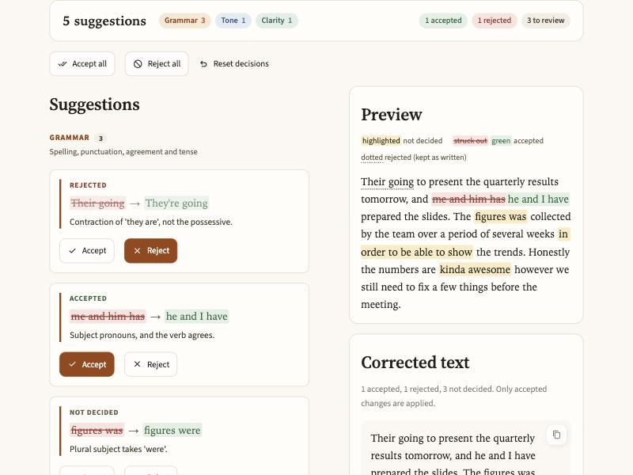
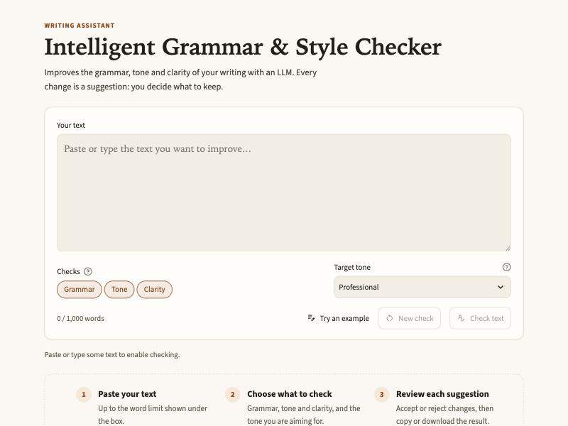
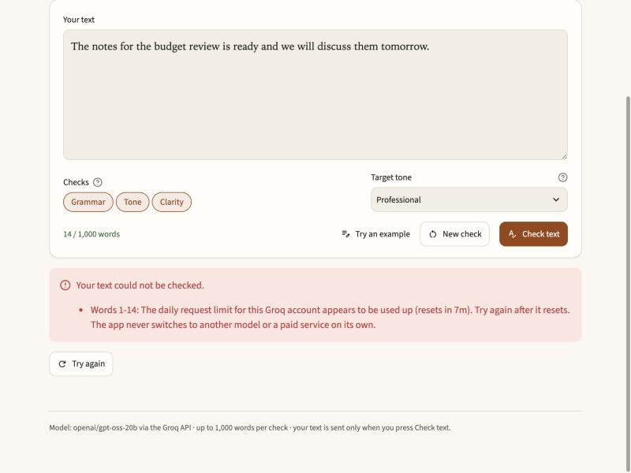
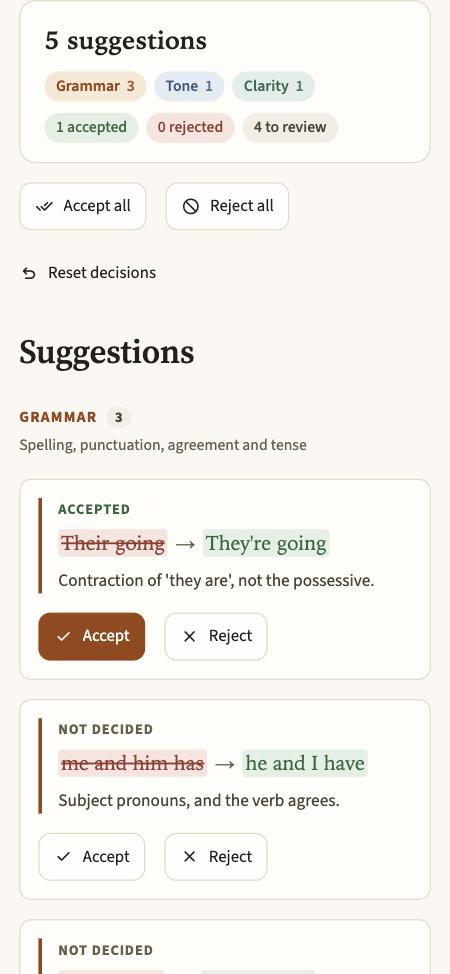
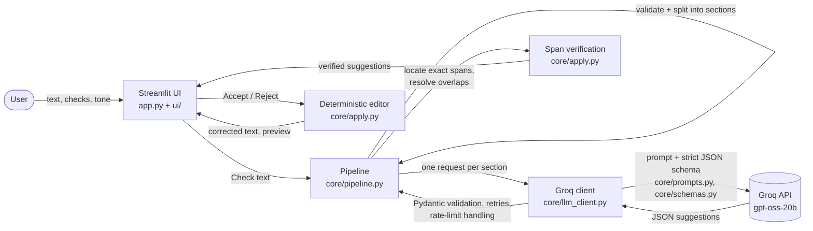

# Intelligent Grammar & Style Checker

Paste text and get **grammar, tone and clarity** suggestions from an LLM, then accept or
reject each one. The corrected text is built by the app from the suggestions you accept, so
nothing changes without your say. Built with Python, Streamlit and the Groq API
(`openai/gpt-oss-20b`).



## Problem and objectives

Writers often need help with three different things: real grammar mistakes, wording that does
not suit the audience, and sentences that are harder to read than they need to be. Generic
"rewrite my text" tools fix all three by rewriting everything, which changes the author's
meaning and voice and makes it impossible to see what was wrong.

This project (HCL project: *"Intelligent Grammar & Style Checker: improves grammar, tone and
clarity via LLM"*) aims to:

1. Detect and correct **grammar** errors: spelling, punctuation, agreement, tense, pronoun
   case, contractions versus possessives, and badly broken sentences.
2. Adjust **tone** towards a chosen target (professional, formal, friendly, casual, confident).
3. Improve **clarity** by removing wordiness and hard-to-follow phrasing.
4. Keep the author in control: every change is a reviewable suggestion with a reason, and
   correct text is left alone.
5. Be reliable and safe: verified edits, honest error reporting, no leaked credentials.

| HCL prerequisite | How it is met |
|---|---|
| Laptop 8 GB | Runs locally; the model runs on Groq's servers, so local memory use is small |
| Python | Python 3.11+ (`core/`, `ui/`, `app.py`) |
| GPT | `openai/gpt-oss-20b`, OpenAI's open-weight GPT model, served through the Groq API |
| Streamlit | The whole user interface (`app.py`, themed in `.streamlit/config.toml`) |

## Screenshots

| Start screen | Error with recovery | Phone layout |
|---|---|---|
|  |  |  |

## Features

- **Three checks** you switch on or off under the text box: Grammar, Tone (with a target
  tone) and Clarity.
- **Minimal, meaning-preserving corrections.** Isolated errors get small edits
  ("Their" → "They're"); a sentence whose errors depend on each other gets one whole-sentence
  fix that keeps the author's words. Correct and merely ambiguous sentences are left alone.
- **Span-based suggestions.** Each suggestion quotes the exact text it changes, shows the
  replacement and a one-line reason, and is verified against your text before it is shown.
- **You decide.** Accept or reject each suggestion, or Accept all / Reject all / Reset.
  A live preview marks every suggestion; the corrected text contains only accepted changes.
- **Copy or download** the corrected text.
- **Honest results.** Suggestions that cannot be verified are counted and explained, never
  silently dropped, and the app never calls a text "clean" when the model's suggestions could
  not be verified. If a later part of a long text fails, the results so far are kept.
- **Long texts** are checked section by section with a progress bar.
- **Accessible, responsive UI:** WCAG AA contrast for all text, visible keyboard focus,
  status shown in words (not only colour), one-column layout on phones.

## Using the app

1. **Write.** Paste or type your text (or press **Try an example**). The counter shows your
   word count against the limit; **Check text** stays disabled, with the reason shown, until
   the text and the selected checks are valid.
2. **Choose checks.** Toggle Grammar, Tone and Clarity and pick a target tone.
3. **Check.** Your text is sent to the API only now.
4. **Review.** A summary shows how many suggestions each check found and how many you have
   accepted, rejected or not yet decided. Cards are grouped by check.
5. **Use the result.** Copy it with the button in the corner of the corrected text, or
   **Download .txt**.
6. **Start again.** **New check** clears everything. If a check fails, the message says why and
   **Try again** repeats it.

## Quick start

Requires **Python 3.11+** and a Groq API key (https://console.groq.com/keys).

```bash
python3.11 -m venv .venv && source .venv/bin/activate
pip install -r requirements.txt            # add requirements-dev.txt to run the tests
cp .env.example .env                        # then put your Groq API key into .env
streamlit run app.py
```

`.env` is git-ignored. Never commit it, and never paste your key into the code or the UI.

## Architecture



Design decisions:

- **The model suggests, the app edits.** The model returns structured suggestions
  (`original`, `replacement`, `explanation`, `category`, `context_before`) under a strict JSON
  schema. The app verifies each quote against the text and applies accepted edits itself, left
  to right from the original string, so the result is reproducible and never depends on the
  model rewriting the whole text.
- **Fail visibly, not silently.** Every suggestion that cannot be verified is reported with its
  reason (not found, inside a word, ambiguous location, overlapping, malformed).
- **Text is data, not instructions.** The user's text is wrapped in random delimiters and the
  prompt tells the model never to follow instructions inside it.
- **Thin UI.** `app.py` holds layout and state only; all logic is in `core/` and all HTML
  fragments in `ui/components.py`, so both are unit-tested.

## Evaluation

`evaluation/` contains a labelled set of 30 sentences across ten groups (broken sentences,
contractions and possessives, agreement, tense, pronoun case, spelling and punctuation,
already-correct text, ambiguous-but-correct text, tone and clarity) and an automatic scorer.
A case passes only if the text the user gets after **Accept all** contains every expected fix
and none of the original errors, or, for correct and ambiguous sentences, comes back exactly
as written.

```bash
python -m evaluation.run_eval            # live run, uses ~30 requests of your quota
python -m evaluation.run_eval --resume   # after a rate limit: re-run only unfinished cases
python -m evaluation.run_eval --only broken-01,tone-02
```

Outcomes are saved in `evaluation/results.json` and merged across runs only while the model,
reasoning effort and prompt stay the same (the prompt is fingerprinted); a case that could
not be checked because of an API error counts as failed until it is re-run.

Each run writes a per-case table to `evaluation/RESULTS.md`. LLM output varies between runs, so
a run is a snapshot, not a guarantee.

**Status:** a full run on the current prompt is pending. The free-tier quota on the
development key was used up during prompt tuning, so the last attempt completed only 2 of the
30 cases (both passed) before Groq's rate limit stopped it. The report will be added once a
complete run is possible.

## Configuration (`.env` or real environment variables)

| Variable | Default | Meaning |
|---|---|---|
| `GROQ_API_KEY` | _(required)_ | Your Groq API key |
| `GROQ_MODEL` | `openai/gpt-oss-20b` | Model ID; must support strict JSON-schema output on Groq |
| `GROQ_TIMEOUT_SECONDS` | `30` | Per-request timeout (passed to the SDK's HTTP client) |
| `GROQ_MAX_RETRIES` | `2` | Extra attempts after the first (timeouts, 5xx, malformed output) |
| `GROQ_MAX_RETRY_WAIT_SECONDS` | `10` | A per-minute rate limit is waited out once only if `retry-after` is at most this |
| `GROQ_REASONING_EFFORT` | `low` | `low`/`medium`/`high`; empty omits the parameter |
| `GROQ_MAX_COMPLETION_TOKENS` | `2500` | Output cap per request (includes reasoning tokens) |
| `MAX_INPUT_WORDS` | `1000` | Longest text accepted |
| `MAX_CHUNK_WORDS` | `400` | Text is sent to the API in chunks of at most this many words |

Real environment variables take precedence over `.env`.

## Error handling

| Situation | Behaviour |
|---|---|
| HTTP 429, per-day quota exhausted (`x-ratelimit-remaining-requests` is 0) | Clear "daily limit" message, no retry |
| HTTP 429, short `retry-after` | Waits once, retries once |
| HTTP 429, long or unknown `retry-after` | Clear message, no retry |
| Timeout, network error, 5xx, malformed or rejected model output | Retried up to `GROQ_MAX_RETRIES` times with backoff |
| Request/response too large (HTTP 413, truncated output) | The section is halved once and retried; if that still fails the section is reported |
| 401/403, 404 (model), other 4xx | Immediate, specific message; no retry, no fallback |
| Failure in a later section | Earlier valid suggestions are kept; failed and skipped sections are listed |

## Security and privacy

- The API key is held only in `Settings.api_key` (excluded from `repr`), is never logged,
  never rendered and never placed in error messages. Logs carry only short error codes.
- Your text is sent to Groq only when you press **Check text**, and is not logged.
- Model output and your text are HTML-escaped before display; no Markdown is rendered from
  them.
- Repository hygiene tests check that `.env` is ignored and that no key-like string is in any
  tracked file.

## Free tier, limits and billing

- The app only uses the configured model through the Groq API. It has **no fallback model or
  provider**; when a limit is reached it shows a clear error and stops calling the API.
- Your actual limits are shown in the Groq console (https://console.groq.com/settings/limits).
- **The app cannot enforce billing.** If your Groq organisation is on a paid plan, requests
  may be billed. Keep your plan on Free if you do not want to pay.

## Tests

```bash
pip install -r requirements-dev.txt
pytest                                 # offline: the Groq client is replaced by a scripted fake
RUN_LIVE_TESTS=1 pytest -m live        # optional: one real request (uses a little of your quota)
ruff check . && ruff format --check .
```

The offline suite never touches the network (sockets are blocked). It covers configuration,
schemas, the Groq client (retries, rate limits, error mapping), span location, overlap and
ambiguity handling, deterministic editing (including randomized checks against a reference
implementation), chunking, partial results and progress, correction-quality regressions, the
Streamlit UI (via `streamlit.testing`), the UI fragments, the evaluation scorer, and repository
hygiene.

## Project structure

```
app.py                  Streamlit UI: page layout, state and callbacks (thin)
ui/components.py        escaped HTML fragments: header, summary, cards, empty and clean states
ui/styles.css           style layer on top of the theme in .streamlit/config.toml
core/config.py          .env / environment -> validated Settings
core/errors.py          typed, user-presentable errors
core/schemas.py         options, strict JSON schema, output validation, result models
core/prompts.py         prompt construction (user text is passed as delimited data)
core/llm_client.py      Groq calls: timeout, bounded retries, 429 and 400 handling
core/pipeline.py        input validation, chunking, orchestration, partial results, progress
core/apply.py           span location, conflict handling, deterministic edits, safe HTML
evaluation/cases.jsonl  labelled evaluation set
evaluation/harness.py   scorer and report
evaluation/run_eval.py  live evaluation command
tests/                  pytest suite
docs/screenshots/       images used in this README
```

## Known limitations

- **LLM output varies.** The same sentence can get a perfect fix on one run and a partial one
  on the next (for example a missing full stop after word-by-word fixes). The evaluation above
  measures this; it cannot be eliminated with a prompt.
- **Very garbled input** forces the model to guess the meaning, and it does not always say so.
- English only. Matching of the model's quoted text is exact, so a quote that differs by one
  character is reported as unverified rather than guessed.
- Sections are checked one after another (free-tier limits are tight), so long texts take
  longer.
- Single-user local app: deployed publicly, all visitors would share one API key and quota.

## Future scope

- A "flag for review" suggestion type for genuinely ambiguous sentences (needs a schema and
  UI change).
- An optional second verification pass on the corrected text to catch leftover errors, at the
  cost of a second request per check.
- Per-check "Accept all" and a dark theme.
- Multilingual checks.
